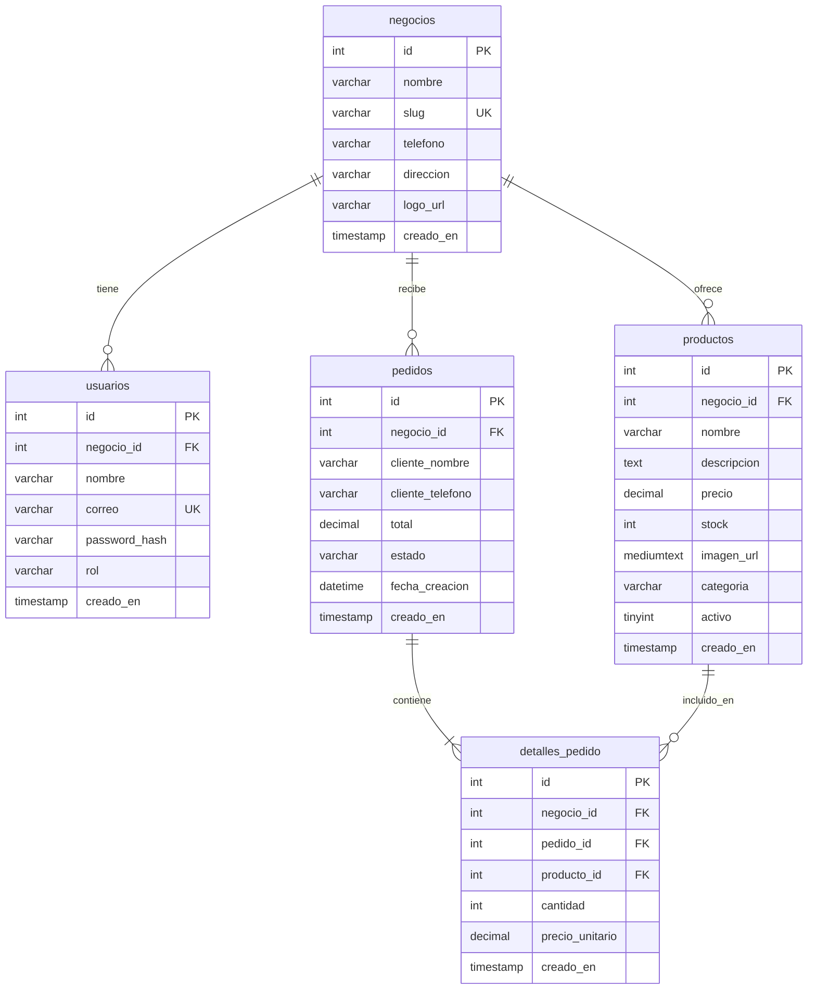

# VendeYa — Documento Integral y Técnico del Proyecto

**Plataforma de Comercio Electrónico Local para El Salvador**  
*Documento de Arquitectura, Implementación y Resumen Completo de Entregas 1, 2, 3 y 4*

---

## 1. Ficha Técnica del Proyecto

| Parámetro | Definición |
|---|---|
| **Nombre** | VendeYa |
| **Público Objetivo** | Emprendedores y comercios locales de El Salvador |
| **Arquitectura** | Frontend SPA (React + Vite) + Backend REST API (Express 5 + Node.js) + Base de Datos Relacional (MySQL / MariaDB sin ORM) |
| **Gestor de Paquetes** | `pnpm` exclusivamente |
| **Moneda** | Dólares de los Estados Unidos (\$ USD) |
| **Roles de Usuario** | **Dueño** (Acceso Total), **Vendedor** (Operación y Pedidos) y **Cliente** (Acceso Público sin Registro) |

---

## 2. Tecnologías Obligatorias Utilizadas

### Frontend
- **React 19 + Vite 8:** Compilación ultrarrápida en JavaScript puro (ES Modules, sin TypeScript).
- **Tailwind CSS v4:** Diseño responsivo para computadora y teléfono celular con estética cálida artesanal salvadoreña.
- **React Router 7:** Enrutamiento del lado del cliente con rutas protegidas según el rol.
- **Zod:** Validación de esquemas de datos del lado del cliente.
- **lucide-react:** Iconografía moderna y ligera.
- **qrcode.react:** Generación vectorial (`QRCodeSVG`) de códigos QR para mostradores físicos.
- **recharts:** Visualización interactiva de ventas históricas (AreaChart) y distribución de estados (BarChart).

### Backend
- **Node.js (v20+):** Entorno de ejecución en módulos ES (`import` / `export`).
- **Express 5:** Servidor HTTP y API REST.
- **mysql2/promise:** Consultas SQL preparadas con marcadores de posición `?`, sin ORM.
- **bcryptjs:** Almacenamiento seguro de contraseñas mediante hashing criptográfico con salt (10 rondas).
- **jsonwebtoken (JWT):** Generación y validación de tokens de sesión con expiración de 7 días.
- **dotenv:** Gestión de variables de entorno para desarrollo y producción.
- **cors:** Configuración segura de orígenes permitidos.

---

## 3. Modelo Relacional de Base de Datos (MySQL)

Toda la base de datos se genera y sincroniza automáticamente mediante código en `backend/src/database/iniciarBaseDatos.js`.



### Usuarios y Contraseñas Registrados en la Base de Datos
- **👑 Dueño:** `carmen@antojitos.sv` / Contraseña: `admin123`
- **🧑‍💼 Vendedor:** `vendedor@antojitos.sv` / Contraseña: `admin123`

---

## 4. Estructura de Entregas y Funcionalidades

### Entrega 1: Cimientos, Base de Datos y Autenticación con Roles
- **Esquemas Zod de Autenticación (`backend/src/schemas/auth.schema.js`):** Validación estricta de correo electrónico y longitud de contraseñas.
- **Middlewares de Seguridad (`backend/src/middlewares/auth.middleware.js`):**
  - `verificarToken`: Extrae y valida el JWT desde la cabecera `Authorization: Bearer <token>`.
  - `verificarRol(...roles)`: Bloquea con código `403 Forbidden` a usuarios que no posean el rol autorizado.
- **Rutas de Autenticación (`backend/src/routes/auth.routes.js`):**
  - `POST /api/auth/login`: Autentica credenciales con `bcryptjs`, genera el token firmado e incluye los datos del negocio sin revelar el hash.
  - `GET /api/auth/perfil`: Datos del usuario conectado.
  - `POST /api/auth/vendedores`: Permite al dueño crear vendedores para su tienda (RN-02).
  - `GET /api/auth/vendedores`: Lista el personal de ventas del negocio.

---

### Entrega 2: Catálogo Público y Gestión de Productos
- **Catálogo Público por Enlace Único (`frontend/src/pages/CatalogoPublico.jsx`):**
  - Acceso mediante slug (`/tienda/:slug`).
  - Buscador reactivo en tiempo real con debounce (nombre o descripción).
  - Filtro por categorías dinámicas según los productos del comercio.
  - Indicadores visuales de stock y estado agotado.
- **Administración de Productos (`frontend/src/pages/ProductosAdmin.jsx`):**
  - CRUD completo para el dueño con validación Zod de precio > 0 y stock $\ge$ 0 (RN-04 y RN-05).
  - Borrado lógico (`activo = 0` en lugar de `DELETE`) para no romper la integridad de pedidos históricos.
  - **Soporte Dual de Imágenes:**
    1. *Subida de archivo local desde la computadora:* Procesa y optimiza la imagen en el cliente mediante un `<canvas>` HTML5 (máximo 800px, JPEG 85%, ~70 KB en Base64). Se almacena directamente en la base de datos MySQL en columna `MEDIUMTEXT`, permitiendo desplegar en Vercel o Render sin necesidad de configurar buckets S3 externos.
    2. *Enlace URL web:* Permite pegar enlaces externos para comercios sin fotos propias.

---

### Entrega 3: Carrito de Compras y Checkout Express Atómico
- **Contexto del Carrito (`frontend/src/context/CarritoContext.jsx`):**
  - Estado global reactivo con persistencia automática en `localStorage`.
  - Funciones de agregar, modificar cantidades (respetando existencias máximas), eliminar y vaciar.
  - Cálculo visual de totales en dólares.
- **Panel Desplegable y Modal de Checkout (`CatalogoPublico.jsx`):**
  - Botón flotante con contador de artículos y monto acumulado.
  - Slide-over con miniaturas, cantidades y botones de incremento/decremento.
  - Checkout express sin registro: solo solicita nombre y teléfono de contacto.
- **Transacción SQL Atómica en el Backend (`backend/src/routes/pedidos.routes.js`):**
  - Ruta `POST /api/pedidos/checkout` protegida bajo `START TRANSACTION`.
  - Bloqueo de filas con `SELECT ... FOR UPDATE` para evitar condiciones de carrera en compras simultáneas.
  - Comprobación de que el producto pertenece al negocio del catálogo (RN-06).
  - Comprobación de existencias suficientes; si no hay stock, revierte con `ROLLBACK` y código HTTP 409 (RN-05).
  - **Cálculo seguro en el servidor:** El total nunca confía en el valor enviado por el navegador; se calcula multiplicando el precio registrado en base de datos por la cantidad solicitada (RN-08, RN-11 y RN-12).
  - Registro de cabecera en `pedidos`, desglose en `detalles_pedido` y descuento inmediato de stock en `productos` mediante `UPDATE productos SET stock = stock - ?`.
  - Confirmación con `COMMIT`.
- **Integración con WhatsApp:** Al confirmar la orden, se genera un enlace `wa.me/` con un mensaje estructurado para notificar al comerciante con un solo clic.

---

### Entrega 4: Gestión de Pedidos, Dashboard con Recharts y Código QR
- **Gestión de Pedidos (`frontend/src/pages/PedidosAdmin.jsx`):**
  - Filtro por pestañas de estado: `Todos`, `Pendiente`, `Confirmado`, `Preparando`, `Listo`, `Entregado`, `Cancelado`.
  - **Máquina de Estados Estricta (RN-09):** Cada tarjeta muestra únicamente los botones de transición válidos (`pendiente` $\rightarrow$ `confirmado`/`cancelado`, etc.).
  - **Restauración de Stock (RN-10):** Si un pedido se cancela, una transacción SQL devuelve las unidades vendidas al stock del producto automáticamente.
  - Botón directo de chat de WhatsApp con el cliente para coordinar la entrega.
- **Dashboard y Analítica (`frontend/src/pages/DashboardAdmin.jsx`):**
  - 4 Indicadores Clave (KPIs): Ingresos totales acumulados (\$), Pedidos recibidos, Pedidos por atender y Catálogo activo.
  - Gráfico interactivo con Recharts: `AreaChart` con ingresos de los últimos 7 días.
  - Gráfico de volumen: `BarChart` con la distribución de pedidos según su estado.
  - **Generación de Código QR con `qrcode.react`:**
    - Genera el código QR hacia la URL pública de la tienda (`/tienda/${slug}`).
    - Botón de copiar enlace público al portapapeles.
    - Botón para imprimir el código QR listo para colocar en el mostrador del negocio.

---

## 5. El Sistema de Roles Integrado

La plataforma cuenta con un sistema de roles integrado en la misma aplicación web:

- **👑 Dueño (`dueno`):**
  - Acceso total a todas las herramientas: Dashboard financiero con Recharts, Catálogo de Productos (CRUD y stock opcional), Pedidos y Generación de QR.
  - Gestión de perfil comercial y personal en `/admin/perfil`: cambio de nombre del negocio (título de la tienda), cambio de correo electrónico y actualización de contraseña.
  - Cuenta con la opción de gestionar vendedores para su negocio.
- **🧑‍💼 Vendedor (`vendedor`):**
  - Acceso operativo a la tienda: Terminal de ventas POS tipo comanda/cajero (`/admin/cajero`) con selección rápida de productos y registro de ventas de mostrador con descuento automático de inventario.
  - Consulta y avance de pedidos en tiempo real (`/admin/pedidos`).
  - Las secciones confidenciales (Dashboard financiero, catálogo de productos y perfil del negocio) quedan completamente restringidas.
- **🛒 Cliente (`cliente`):**
  - Acceso público directo desde la raíz de la web (`/` y `/tienda/:slug`) sin requerir inicio de sesión ni registro.
  - Visualización del catálogo con tipografía ampliada de alto contraste, buscador en tiempo real, filtros y carrito reactivo.

---

## 6. Características de Accesibilidad y Personalización

- **🌓 Modo Oscuro Reactivo:**
  - Alternador de tema integrado en el `Navbar` (íconos de Sol y Luna con `lucide-react`).
  - Persistencia automática de la preferencia del usuario en `localStorage` (`vendeya_tema_v1`).
  - Soporte global de Tailwind v4 con `@custom-variant dark` y paleta de colores de alto contraste (`#0c0a09` / `#f5f5f4`) en todas las pantallas.
- **🏷️ Título del Negocio y Correo Editables:**
  - Endpoint `PUT /api/auth/negocio` para que el dueño actualice el nombre de su negocio en cualquier momento.
  - Endpoint `PUT /api/auth/perfil` con validación Zod de formato y comprobación de correo único.
- **📦 Stock Opcional:**
  - El inventario ahora es opcional al crear o modificar productos (valor predeterminado en `0`), ideal para servicios o productos bajo demanda.
- **🔤 Tipografía Ampliada de Alto Contraste:**
  - Títulos de productos aumentados a `text-lg sm:text-xl font-black` con clases de contraste específico para garantizar lectura clara tanto en modo claro como oscuro.

---

## 7. Guía de Despliegue en Producción (Vercel + Cloud)

Debido a que Vercel es una plataforma *Serverless* (sin servidor de base de datos persistente en disco), la arquitectura de despliegue recomendada y gratuita es:

1. **Base de Datos MySQL (Aiven for MySQL o TiDB Serverless):**
   - Se crea una instancia gratuita de MySQL en la nube.
   - En `backend/src/db.js` ya se encuentra configurada la directiva SSL (`ssl: process.env.DB_SSL === 'true' ? { rejectUnauthorized: false } : undefined`) para establecer conexiones seguras.
2. **Backend API (Render.com o Railway):**
   - Se despliega el servicio web Express conectándolo con las variables de base de datos de Aiven.
3. **Frontend (Vercel):**
   - Se conecta el repositorio de GitHub de `frontend`.
   - Se añade la variable de entorno:
     ```env
     VITE_API_URL=https://tu-backend-en-render.onrender.com/api
     ```
   - En `frontend/src/config/api.js`, la aplicación utiliza automáticamente esta URL en producción y `http://localhost:3000/api` en desarrollo local.

---

## 7. Verificación del Sistema Paso a Paso

Para comprobar el correcto funcionamiento de cada módulo, sigue estos pasos:

1. **Verificación de la Tienda Pública del Cliente:**
   - Ingresa a [http://localhost:5173/tienda/antojitos-santa-tecla](http://localhost:5173/tienda/antojitos-santa-tecla).
   - Realiza búsquedas en tiempo real (ej. "pupusas" o "café").
   - Haz clic en "Agregar al carrito" en varios productos.
   - Abre el carrito lateral y haz clic en "Proceder al Checkout Express".
   - Confirma el pedido y haz clic en el botón de WhatsApp.

2. **Verificación del Rol Vendedor:**
   - Ingresa a [http://localhost:5173/login](http://localhost:5173/login).
   - Haz clic en **"🧑‍💼 Vendedor (Operación de Tienda)"**.
   - Revisa la lista de pedidos en `/admin/pedidos` y avanza el estado del pedido (Confirmar $\rightarrow$ Iniciar Preparación).
   - Haz clic en **"Nuevo Pedido"** en la barra superior y registra una orden de mostrador. Observa cómo se añade inmediatamente a la lista.
   - Intenta ingresar por URL a `http://localhost:5173/admin/dashboard`; verificarás que la pantalla de *Acceso Restringido* bloquea el paso.

3. **Verificación del Rol Dueño:**
   - Haz clic en el botón de cerrar sesión y selecciona **"👑 Dueño (Acceso Total)"**.
   - Entrarás al **Dashboard**: revisa las métricas de ventas y el gráfico Recharts.
   - Ingresa a **"Mis Productos"**: edita un precio o crea un producto subiendo una foto desde tu computadora.
   - Escanea el código QR en pantalla con tu celular para abrir la tienda pública.
